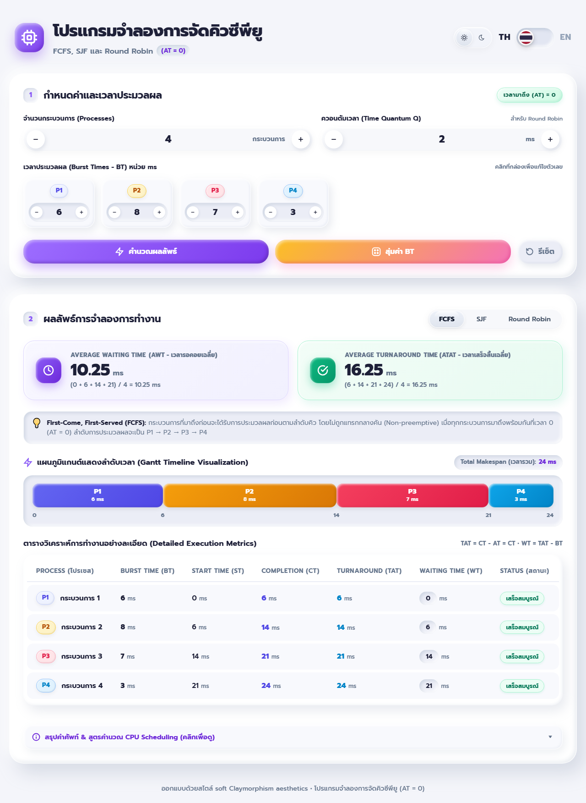
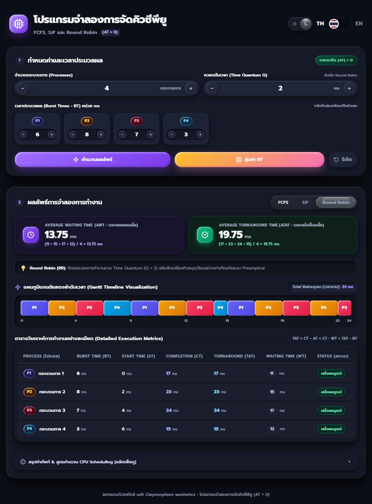

# CPU Scheduling Simulator (AT = 0)

An interactive, responsive CPU-scheduling simulator built with vanilla HTML/CSS/JS and soft **Claymorphism** aesthetics. FCFS, SJF and Round Robin run on the numbers you enter and are visualised with a proportional Gantt timeline, a full metrics table and step-by-step formula breakdowns — under the uniform arrival-time condition **(AT = 0)**.

🔗 **Live demo:** <https://nuuice5412.github.io/cpu-scheduler/>

---

## 📸 Screenshots

| Light theme — FCFS | Dark theme — Round Robin (13 slices) |
| :---: | :---: |
|  |  |

---

## ✨ Key Features

### Scheduling algorithms

1. **FCFS (First-Come, First-Served)** — non-preemptive, executes strictly in input order.
2. **SJF (Shortest Job First)** — non-preemptive, shortest burst first, FCFS order as the tie-breaker for equal bursts.
3. **Round Robin (RR)** — preemptive, cyclic slices of the configured time quantum. Context-switch overhead is assumed to be **0 ms**.

### Results

- **Gantt timeline** — the bar is a CSS grid whose columns are `BT fr` units, so every block edge lines up exactly with its timestamp. With more than 8 slices the chart switches to a compact mode (smaller radius, slice durations hidden) and the axis thins out its labels instead of overlapping them.
- **Metrics table** — Burst Time, Start Time, Completion Time, Turnaround Time, Waiting Time and status for every process.
- **Summary cards** — Average Waiting Time and Average Turnaround Time with the full arithmetic, e.g. `(0 + 6 + 14 + 21) / 4 = 10.25 ms`, plus the total makespan.

### Input & controls

- **1–10 processes**, **Burst Time 1–50 ms**, **Time Quantum 1–20 ms** — limits are enforced by validation, not only by the `max` attribute.
- Stepper buttons with hold-to-repeat that stops automatically when the window loses focus.
- Slot-machine cascade animation when randomising burst times.
- Localised validation messages (TH/EN) for every rule, including the process-count / field-count mismatch.
- **Enter** anywhere in the form calculates (the calculate button is the form's submit button).

### Interface

- Thai / English toggle, persisted in `localStorage`.
- Light / dark theme with a liquid-glass slider, persisted in `localStorage` and defaulting to the OS preference.
- Responsive down to phone widths; the results table scrolls horizontally instead of squashing its columns.
- Print stylesheet: on-screen controls are hidden and the Gantt keeps its colours on paper.

---

## ♿ Accessibility

- **Tabs follow the WAI-ARIA APG pattern**: roving `tabindex`, arrow-key / Home / End navigation, `aria-selected`, and the tabpanel's `aria-labelledby` follows the active tab.
- An **`aria-live` region** announces AWT / ATAT / makespan after each recalculation.
- The Gantt exposes a **text description of the schedule** (first slices plus a slice count); the numeric axis is `aria-hidden` so screen readers are not read hundreds of numbers.
- **Focus feedback**: buttons and tabs show a ring only for keyboard users (`:focus-visible`), and focused number fields highlight their capsule.
- Every input and button has an accessible name, and a `<noscript>` notice explains that JavaScript is required.

---

## 📐 Formulas & Theoretical Background (AT = 0)

All processes enter the ready queue simultaneously at `t = 0`, so the metrics reduce to:

| Metric | Symbol | Definition | Formula (AT = 0) |
| :--- | :---: | :--- | :--- |
| **Burst Time** | $BT$ | CPU time the process needs to finish | user input (ms) |
| **Start Time** | $ST$ | First timestamp at which the process receives the CPU | first scheduled tick |
| **Completion Time** | $CT$ | Timestamp at which the process finishes | final execution tick |
| **Turnaround Time** | $TAT$ | Elapsed time from arrival to completion | $TAT = CT - AT = CT$ |
| **Waiting Time** | $WT$ | Total time spent waiting in the ready queue | $WT = TAT - BT$ |
| **Average Waiting Time** | $AWT$ | Mean waiting time over $N$ processes | $AWT = \frac{1}{N}\sum_{i=1}^{N} WT_i$ |
| **Average Turnaround Time** | $ATAT$ | Mean turnaround time over $N$ processes | $ATAT = \frac{1}{N}\sum_{i=1}^{N} TAT_i$ |

---

## 🧭 Behaviour notes

- Results are **always derived from the fields on screen** — there is no hard-coded sample data behind the UI.
- Switching **language** re-renders the current results in the new language without losing them.
- If the form is **invalid**, switching tabs or languages does **not** recompute: the previous results stay on screen and a message explains what to fix.
- **Reset** restores the default burst times (6, 8, 7, 3), process count 4 and quantum 2, then recalculates.

---

## 📂 Project structure

```text
cpu-scheduler/
├── index.html            # markup, bilingual i18n dictionaries, UI interaction
├── styles.css            # claymorphism tokens, dark theme, responsive + print styles
├── app.js                # scheduling engine (FCFS, SJF, RR) + DOM rendering
├── docs/                 # screenshots used by this README
├── tests/
│   ├── engine.spec.js    # the 51 assertions, shared by both runners
│   ├── engine.test.js    # command-line runner (Node.js)
│   └── engine.test.html  # browser runner — opens like a normal page, no install
├── package.json          # only a `test` script — no dependencies to install
└── README.md
```

---

## 💻 Getting Started

No build tools, bundlers or package installation are required:

1. Clone or download this repository.
2. Open `index.html` directly in a modern browser.

Optional — if you prefer serving it over HTTP (for example to test the print stylesheet or keep `localStorage` per origin):

```bash
python -m http.server 8000
# then open http://localhost:8000
```

---

## ✅ Running the tests

The same **51 assertions** (defined once in `tests/engine.spec.js`) can be run two ways.

### Option 1 — In the browser (no installation needed)

Open **`tests/engine.test.html`** — double-click it, or drag it into any browser. The page runs the specs against the real engine and shows `ALL PASS (51)` in green.

### Option 2 — On the command line (requires Node.js)

```bash
# from the project root (the folder that contains index.html)
node tests/engine.test.js

# or from inside tests/
node engine.test.js

# or via npm — there are no dependencies, so no npm install is needed
npm test
```

> If PowerShell answers `The term 'node' is not recognized`, Node.js is not installed (or not on `PATH`). Install the LTS build from [nodejs.org](https://nodejs.org), open a **new** terminal and verify with `node -v`. Until then, Option 1 works without Node.

Expected output (51 assertions):

```text
FCFS — burst times 6, 8, 7, 3
  PASS  execution order
  PASS  AWT
  ...

Worst case allowed by the UI — 10 processes x 50 ms
  PASS  slice count
  PASS  makespan

----------------------------------------------
ALL PASS (51)
```

The script exits with **0** when everything passes and **1** on the first failure, so it can be wired into CI as-is.

---

## 🌐 Browser support

- Chrome / Edge **105+**, Safari **15.4+**, Firefox **121+** — the theme slider and the language highlight rely on CSS `:has()`.
- No polyfills are shipped; on older browsers the app still runs but those two decorative highlights do not follow the active state.

---

## ⚠️ Limitations

- Arrival time is fixed at **0** (there is no AT input by design).
- No I/O bursts, priorities or context-switch overhead.
- Practical ceiling of **10 processes × 50 ms** keeps the timeline readable; the validation enforces it.

---

## 🛠️ Technology Stack

- **HTML5** — semantic landmarks, forms and ARIA attributes.
- **CSS3** — custom properties, layered claymorphism shadows, CSS grid for the Gantt, `prefers-color-scheme`, print media.
- **Vanilla JavaScript (ES6+)** — pure scheduling functions, reactive DOM rendering, zero runtime dependencies.
- **Node.js** — used only to run the engine tests (no runtime dependency).
